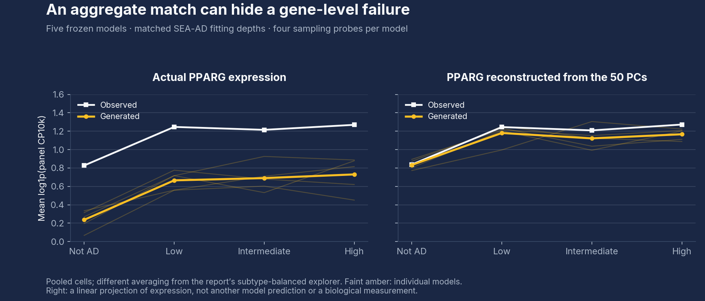

# ALZ: a generative model of human microglia

[**Read the evidence report →**](https://difflabai.github.io/alz-perturb-gan/)

The published report examines five frozen ParticleGAN 0.9.7 models of human microglial gene-expression distributions at four Alzheimer’s neuropathology stages. The current experimental CLI default uses native EMPF on ParticleGAN 0.10.0. This repository contains the research code, experiment history, aggregate results, and a shareable report examining what the trained models actually support. [STATUS.md](STATUS.md) gives the current state, work in progress and a reading order.

**Dataset: SEA-AD middle temporal gyrus.** This is an independent proof of concept. Prima Mente’s challenge atlas is planned for Spring 2027 and was not used for training or analysis here. These are not challenge benchmark results.

The current model conditions on **pathology stage**, not gene edits or compounds. It is an observational proof of concept for generating cell populations and prioritizing experiments. It does not predict a treatment response, and we have not demonstrated state-of-the-art performance.

## Current experimental default

The [application config](configs/microglia_default.json) and [CLI](scripts/microglia.py) now select **ParticleGAN 0.10.0, the released native EMPF preset, `pbulk`, 20,000 updates**. This is an **owner-selected experimental default**, chosen after the fixed release comparison. The default generation command loads the retained, fully trained **fold 0/seed 0** model (25 training donors, 12 held-out development donors). It is not a full-cohort refit.

Both EMPF comparison fits completed 20,000 updates. Each final checkpoint records exactly **20,000 regularizer calls in 20,000 updates (`lazy_k=1`)**. The selected native preset uses generator/critic/prior learning rates **0.012/0.018/0.03**, prior regularization 0.01 and EBI beta 6. The shared-parameter variant tested separately is not selected.

In the one-fold/seed pilot, native EMPF improves profile RMSE **1.57%**, SD interval score **2.36%**, and combined interval score **0.67%** against the previous default. Gene mean, detection and log-variance errors worsen, and coverage also regresses. Empirical resampling still wins both interval scores. This application choice does **not** change those results, pass the prospective promotion rule, or establish population qualification. See the [comparison](analysis/empf_comparison_20261117/completion/comparison.json), [independent audit](analysis/empf_comparison_20261117/completion/independent_final_review.json), and [owner-selection record](analysis/default_empf_20261117/selection.json).

The readout remains **`cellshape@0.5:biascal:stagehalf`**: six late states (15,000 through 19,000 plus final), half-shrunk stage conditioning, fixed within-donor mean contraction and training-only joint bias/dispersion calibration. Each generated donor contains 256 dependent cells; generation uses 32 donors per target. No sealed or external donor counts were used.

Inspect or use the default:

```bash
PY=/mnt/nvme/ai/conda/anaconda3/bin/python3
$PY -B scripts/microglia.py config
$PY -B scripts/microglia.py generate --dry-run
# Use the retained selected model; output is outside the frozen fit:
$PY -B scripts/microglia.py generate
# Fresh 20k training/resume in a separate application output directory:
CUDA_VISIBLE_DEVICES=1 $PY -B scripts/microglia.py train --fold 0 --seed 0 --device cuda --dry-run
CUDA_VISIBLE_DEVICES=1 $PY -B scripts/microglia.py train --fold 0 --seed 0 --device cuda
```

The [runtime instructions](analysis/default_empf_20261117/README.md) describe setup, checkpoint paths and alternative readouts. `--fit` explicitly selects another compatible native EMPF fit. Training uses a separate output root and does not overwrite the retained pilot. GPU memory is capped at 4% and CPU use at three threads. The root package installation remains the earlier synthetic smoke project.

The lipid–lysosome feature audit found one of seven lipid markers and zero of nine lysosome markers in the default EMPF panel. The [paper-watch readout and panel check](paper_watch/notes/seaad_ll_microglia_readout.md#applicability-to-the-default-microglia-model) document the centroid baseline and the gene coverage needed for a cross-module analysis.

The public PsychAD diagnostic uses a broader gene panel to show how training duration changes the generated relationship between lipid and lysosome expression. [Diagnostic and results](paper_watch/notes/psychad_program_readout.md)

The [previous 0.9.7 default config](analysis/improve_20261109/default_config.json), its [selection evidence](analysis/improve_20261109/default_config_distribution_evidence_20261113.json), and all original benchmark receipts remain historical records. Their source hashes are preserved; the previous public entrypoint is [archived byte for byte](analysis/default_empf_20261117/previous/microglia.py). The published report and the biological findings below still describe the original frozen 0.9.7 models; they were not recomputed using EMPF.

A subsequent [coverage improvement pilot](analysis/coverage_empf_20261117/README.md) halves the inherited count-readout contraction. On the same native EMPF fold/seed, variability coverage rises **58.3% → 62.2%**, combined coverage **69.2% → 71.5%**, and their proper interval scores improve **17.2% and 7.4%**. Separate SD-only calibration with disjoint six-donor calibration/test halves gives **86.7% / 83.7%** coverage with wider ranges and better proper scores. This is an experimental count-readout and interval-calibration result; additional native folds/seeds are needed before changing the public default. A [pre-declared 17-fit fold/seed confirmation](analysis/coverage_empf_confirm_20261120/PROTOCOL.md) of the default and this readout started on 2026-11-20; [STATUS.md](STATUS.md) records whether it has finished.

A separate [CPU probe of ParticleGAN 0.10.0](analysis/particlegan_review_20261117/README.md) found that, in a controlled two-group example, EMPF's transport residual reports a perfect match after two conditions swap their spreads when inputs are wider than 64 features (tested at 65 and 2,150); the default trains with 2,150. Whether this affects trained samples, including the undercoverage above, is untested.

## Frozen report findings (ParticleGAN 0.9.7)

Training used 14,762 SEA-AD middle temporal gyrus cells from 33 donors, a 2,000-gene panel, and five independent 20,000-update fits. All five fits started from scratch using the released ParticleGAN 0.9.7 formulation, with generator EMA disabled. We sampled 12.8 million unique synthetic cells from the frozen models; this adds no biological donors.

The resulting analysis supports **CLEC5A as a candidate for a human microglial experiment**:

- Within two donor-supported subtypes, its observed High-minus-Not-AD contrast is **+0.489** and the five-model mean is **+0.454** on the mean per-cell log1p(panel CP10k) scale.
- All five models and all 40 Monte Carlo contrasts agree on the positive direction. The observed association remains positive after donor-covariate adjustment and stage-specific donor-deletion checks.
- The primary external ROSMAP pathology association agrees in direction, with published global FDR **0.00628**.
- The model misses the observed Low-stage peak: its average profile peaks at Intermediate. A consistent endpoint contrast is not an accurate full stage profile.

[Published mouse knockout experiments](https://pubmed.ncbi.nlm.nih.gov/39443966/) motivate testing **reduction** of CLEC5A. That direction does not come from our stage-conditioned generator. The proposed human-cell test measures amyloid uptake and degradation, viability, inflammation, and synapse loss together. CLEC5A is an existing biological lead, not a newly discovered target.

## How well it fits

<details>
<summary>Technical calibration sanity check</summary>

Four calibration donors were used during hyperparameter selection. These are selection results, not an independent final test. Means across five fits and two generation replicates per fit:

| Metric | Generator | Matched resampling | Interpretation |
| --- | ---: | ---: | --- |
| Donor energy score ↓ | 2.0069 | 2.0946 | Generator 4.2% lower; better in 4/5 fits |
| Cell energy distance ↓ | 0.2842 | 0.2349 | Generator 21.0% higher; worse in 5/5 fits |
| Central 80% donor-summary coverage | 64.7% | 68.4% | Both below nominal 80% |

Resampling reuses observed cells; it is an empirical reference, not a trained neural network or a model-architecture benchmark.

</details>

Across the 2,000 correlated genes, the within-subtype training-association comparison has descriptive Spearman correlation **0.502** and direction agreement **65.9%**. It is not held-out gene-prediction accuracy. The report includes failed/sensitive signals, sex/APOE imbalance, incomplete marker coverage, and a comparison with the simpler real-data-plus-literature workflow that still needs to be done.

<details>
<summary>Why PPARG fits poorly: a tested blind spot in the application</summary>

The critic sees 150 bag summaries derived from 50 fixed PCs, rather than the 2,000 genes directly. In a fresh matched-depth diagnostic, observed Not AD PPARG expression averaged **0.827**, versus **0.237** generated. Yet their linear PC reconstructions were **0.838** and **0.833**. About **99% of this signed mean gap** lies outside the PC column space; that component never reaches the critic. Across the other stages, the corresponding shares were 89%, 83%, and 80%. These are components of a mean difference, not percentages of causal responsibility or energy-distance error.



This affects the training signal: adding log(4) to PPARG’s output bias, with the original softmax and valid Gamma–Poisson sampling, reduced the pooled Not AD mean-expression gap by **59%**. The frozen critic loss nevertheless worsened in **four of five** models. A discrete Poisson derivative also opposed increasing PPARG in those four models, so the straight-through gradient cannot be the sole explanation. At Intermediate stage, straight-through and discrete gradient estimates had opposite signs in three model-level averages; their sampling uncertainty and contribution to training remain separate questions.

These are frozen-model probes, not a trained repair. We have identified missing gene-level constraints and a locally misaligned training signal in our count/PCA application; this does not establish a defect in released ParticleGAN. The next causal test is matched fresh training that changes what the critic observes while preserving the ParticleGAN update rule, with the count-gradient ablation kept separate. The diagnostic uses pooled fitting cells with stage-matched observed depths, so its means differ from the report’s subtype-balanced explorer. No weights or published benchmark results were replaced.

Reproducible code/results: [PC error decomposition](analysis/PPARG_PCA_blindspot_CPU_20261108.json), [critic and gradient probes](analysis/PPARG_critic_gradient_CPU_20261108.json), and [actual output-bias response](analysis/PPARG_output_bias_CPU_20261108.json). Each includes input hashes and interpretation limits. All probes ran on CPU with zero optimizer updates.

</details>

## Inspect the evidence

- [Interactive report and all-gene explorer](https://difflabai.github.io/alz-perturb-gan/): four-stage curves, five-seed effects, external cohort checks, donor sensitivity, and a concrete experiment proposal.
- [All 2,000 gene results, CSV](docs/evidence/genes.csv), [portable aggregate data](docs/evidence/report-data.json), and [SHA256 provenance manifest](docs/evidence/manifest.json).
- [Frozen inference plan](analysis/primamente_inference_hypothesis_plan_20261108.json), [model quality review](analysis/primamente_model_capability_review_20261108.json), [donor sensitivity](analysis/primamente_donor_covariate_sensitivity_20261108.json), and [selected CLEC5A numerical audit](analysis/primamente_selected_CLEC5A_numerical_audit_20261108.json).
- [Registration suggestion and its evidential basis](docs/prima-mente-suggestion.md).

The screen retains 614 stable exploratory signals, 107 with primary ROSMAP support, and 58 that additionally pass the donor sensitivity filter. These counts are not significant discoveries or an estimate of predictive precision. Only three training donors are Not AD; none carry APOE4. Important genes including APOE, TREM2, and INPP5D are absent from the measured panel.

## Repository map

| Path | Contents |
| --- | --- |
| `STATUS.md` | Current state, in-progress work and reading order |
| `configs/`, `scripts/microglia.py`, `scripts/microglia_runtime.py` | Current experimental EMPF application: default config and CLI |
| `tests/` | Current application tests (`test_microglia_*.py`), repository documentation checks, and the legacy smoke-project tests |
| `paper_watch/` | CPU harness, tests and notes converting new papers into small checks ([README](paper_watch/README.md)) |
| `analysis/<study>_<date>/` | Dated, frozen studies; the newest describe the current default ([index](analysis/INDEX.md)) |
| `analysis/` (top level) | Versioned research scripts, plans, audits and results from the 0.9.x lineage, kept in place because records pin their paths |
| `analysis/faithful097/model/` | Released ParticleGAN 0.9.7 integration used in the research lineage |
| `docs/` | Static report, downloadable aggregate evidence, figures, and earlier project archive |
| `scripts/report/` | Portable report builder, original stage-profile exporter, and explorer verification |
| `scripts/hygiene/` | Repository maintenance scripts, such as the `analysis/INDEX.md` generator |
| `envs/`, `scripts/check_env.py` | Environment recipes (pinned microglia research interpreter, legacy and paper-watch) and a checker ([README](envs/README.md)) |
| `.github/workflows/`, `scripts/ci/` | CPU-only CI checks without data, checkpoints or GPU ([how to run tests](tests/README.md)) |
| Root `*_runtime/`, `*model/`, `prepare_*.py`, `test_*.py`, `*.json` | Nov 3-8 experiment snapshots and records, not maintained ([legacy layout](docs/LEGACY_LAYOUT.md)) |
| `src/alz_perturb_gan/`, `results/smoke_results.json`, `pyproject.toml` | Earlier synthetic perturbation/decision-model experiment, preserved as legacy work |
| `runs/`, `artifacts/`, `data/` | Local only and git-ignored: fits and outputs, isolated ParticleGAN releases, raw cells |

The original perturbation smoke experiment used PG 0.8.0, synthetic data, and a different objective. Its [archived README](docs/archive/early-perturbation-smoke.md) explains that experiment. **The root `pyproject.toml` still installs that legacy package; it is not the environment recipe for the current human-microglia model** (see [envs/README.md](envs/README.md)). The [earlier literature-only suggestions](docs/archive/early-literature-suggestions.md) are also archived rather than presented as outputs of the current model.

All versioned research history is preserved. Raw cell data, local environments, model checkpoints, and machine credentials are not included. Original research runners require their recorded data/environment setup; not every historical script is a portable command-line tool. The report itself is portable.

## Rebuild the report

Use Python 3.10 or newer:

```bash
python3 -m pip install -r scripts/report/requirements.txt
python3 scripts/report/build_report.py
python3 scripts/report/build_report.py --check
python3 -m http.server 8765 --directory docs
```

Open `http://localhost:8765`. No GPU, raw cells, checkpoints, or external requests are needed to build or browse the report. See [report build instructions](scripts/report/README.md) for the explorer checks and provenance details. GitHub Pages serves the static `docs/` directory on `main`.

## Sources and scope

Human training data: [SEA-AD](https://brain-map.org/consortia/sea-ad). Primary external association: [Mathys et al., Cell 2023](https://doi.org/10.1016/j.cell.2023.08.039), using the [pinned ROSMAP author repository](https://github.com/mathyslab7/ROSMAP_snRNAseq_PFC/tree/28388f829be6affa1578e56fa09c4be8cd273817). Full biological references and interpretation limits are linked in the report.

Prepared while exploring the [Prima Mente Alzheimer’s Translation Challenge](https://www.primamente.com/challenges/). No affiliation or clinical claims. Repository code and report are MIT licensed; third-party data retain their own terms.
