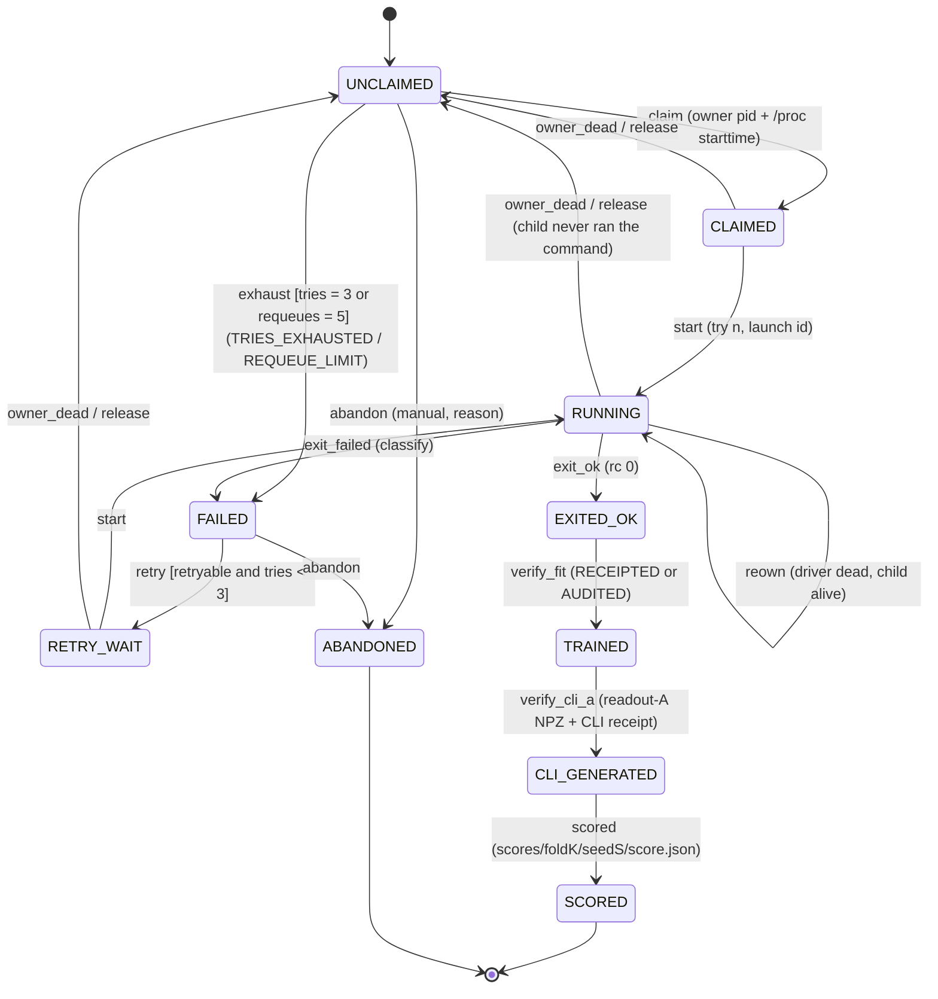

# Confirmation queue: anchored scorer and explicit job ledger

This note covers two additions to the EMPF confirmation pass ([PROTOCOL.md](PROTOCOL.md)).
Neither one changes a file that the running queue reads.

- **Part A, anchored scorer.** `score.py`, `analyze.py`, `test_confirm.py` and
  `source_manifest.json` are tracked byte-identical to the copies the live
  queue hash-checks. They were committed upstream in c59c2fa while this branch
  was being built, and the branch merges that commit rather than adding
  second copies. `gate_freeze.json` records the analysis pins and the GUARDS
  thresholds as of the first score.
- **Part B, job ledger.** [`queue_state.py`](queue_state.py) turns the queue's
  implicit job state into an explicit per-job state machine. It reads the
  legacy layout without writing to it and provides a Python driver for use
  after the drain.

`train_queue.sh` and `train_all.sh` stay byte-identical. The live bash process
reads its script lazily, so editing either file under a running queue would
change what it executes.

## Part A: gate freeze

PROTOCOL.md says: "No read-out, threshold, fold or metric may be added after
the first new score exists". `score.pin_analysis()` rewrites
`source_manifest.json` with whatever `analyze.py` and `test_confirm.py`
contain when it runs, so a post-result edit followed by a re-pin would leave
no trace. `gate_freeze.json` records the following:

- the `analysis_sources` sha256 of `analyze.py` and `test_confirm.py`;
- the `GUARDS` dict from both `score.py` and `analyze.py`, extracted by `ast`
  (value and source text);
- `first_score_cutoff`: the mtime of the pilot's `A_raw_score.json` under the
  current scoring pins (2026-11-20T06:41:10Z). The superseded first pilot score
  from 04:02:16Z is also recorded. Both analysis files were last modified
  before the cutoff (06:26 and 06:27); `pin_analysis()` ran at 06:41:31.

`tests/test_confirm_gate_freeze.py` checks the committed files against
`source_manifest.json` and `gate_freeze.json`. Changing `GUARDS`, `analyze.py`
or `test_confirm.py`, or re-pinning `analysis_sources`, fails the test and
appears as a git diff. `score.py` is frozen as a whole: its sha256 must equal
`score_py_sha256` (re-pinning `execution_sources` does not help), so a
threshold outside `GUARDS` cannot change either. Both files are also scanned
by `ast` for anything that changes `GUARDS` after its one display assignment
(item or attribute stores, `del`, `|=`, `.update()` and other mutating calls,
a second assignment, `global GUARDS`). A deliberate later `score.py`, such as
the post-drain two-step write below, is accepted only when it is listed in
`score_py_post_freeze` with its sha256 and a reason. To regenerate the freeze deliberately (for example for
an exploratory, labelled analysis), call `build_freeze()` from that test
module and commit the diff with the reason.

### Deferred to a post-drain follow-up

`score.py` is pinned, and the live queue checks its hash, so these fixes wait
until the drain:

1. **Scorer two-step write.** `score.py` writes `<label>_raw_score.json`,
   the crossfitted NPZs and `score.json` as separate files. A crash between
   them leaves a partial score directory. `analyze.py` treats a fit without
   `score.json` as missing and checks the raw-score hashes recorded in it, so
   a partial directory is not misread. It still has to be cleaned up by hand
   before a rerun. The fix is to write everything into
   `scores/foldK/seedS.partial.<rand>/`, fsync it, and then `os.replace` it to
   `scores/foldK/seedS/`. The ledger's SCORED state then only needs one atomic
   marker.
2. **Per-fit lock.** Two `score.py` processes for the same fit can currently
   interleave writes. The fix is a `durable_state.FileLock` on
   `scores/foldK/seedS` for the whole scoring run. Activation already has
   `ACTIVATION_LOCK`; the per-fit lock is separate.

After the drain, both changes need a deliberate `pin_sources` refresh, which
must not happen while any score exists (`pin_sources` refuses), or a new
confirmation directory. They are not part of this branch.

## Part B: the job machine



ABANDONED can also be reached from RETRY_WAIT, EXITED_OK, TRAINED and
CLI_GENERATED. It cannot be reached from CLAIMED or RUNNING: the owner has to
be gone first.

Not drawn: the **legacy mirror** edges `legacy_<state>`, from every
non-terminal state except ABANDONED to every state except ABANDONED. They are
guarded by `legacy_tracked` and only `sync_legacy()` uses them (see Legacy
adoption below). `release` and `owner_dead` both re-queue without spending a
try and both count towards the requeue cap. `owner_dead` means the owner died.
`release` means the owner gave the job back because the job command never ran
(the wrapper exited 75 or died before recording itself, or `start` was
refused).

Each job's state lives in `<ledger>/fold<F>_seed<S>.json`, a
`durable_state/1` document. Next to it are its journal and its `.lock`. Every
transition takes the job's flock, checks the edge and the guard, and writes
`version+1` atomically.

**Failure reasons** come from `classify(log tail, rc, fit dir)`, applied in
this order:

| reason | evidence | retryable |
|---|---|---|
| HOST_DIFFERS | `existing derived EMPF host differs` | yes |
| HOST_PARTIAL_IMPORT | SyntaxError/IndentationError/ImportError/ModuleNotFoundError plus the derived host path (`alz-host-empf-native`) | yes |
| KILLED | rc missing, 137 or 9 | yes |
| OOM | `CUDA out of memory` / `OutOfMemoryError` | no |
| OUTPUT_EXISTS | `FileExistsError`, or rc 2 with an exists/outside message | no |
| SOURCE_CHANGED | the runtime's or the confirmation's source/manifest-changed messages | no |
| GENERATION_FAILED | fit has `final.pt` + `fit_receipt.json` but the CLI failed | yes (the CLI resumes a complete fit straight to generation) |
| TRAIN_ERROR | anything else | no |

A job gets at most 3 classified attempts (`tries <= 3`). If a driver crashes,
its jobs are re-queued (`requeues`). A crash does not use up an attempt.
A job that is UNCLAIMED with no attempts left (3 tries, which adoption can
produce, or 5 requeues) is not claimable. The next claim pass moves it to
FAILED with `TRIES_EXHAUSTED` or `REQUEUE_LIMIT` (not retryable). It is then
terminal for the derived queue state and needs an operator to fix or abandon
it. Until then, `status` shows the reason in `blocked`.

**Ownership.** A claim belongs to the driver's pid and its `/proc` starttime,
so a reused pid counts as dead. A running attempt belongs to its child. The
`_child` wrapper takes the flock on `<ledger>/children/fold<F>_seed<S>.try<n>.run`
without blocking, holds it for its whole life, and passes the lock fd on to
the job command. If the lock is busy, or the ledger no longer says RUNNING
with the wrapper's launch id, the wrapper exits 75 without running anything.
That is how a late-starting wrapper finds that recovery has moved on. When the
job command exits, the wrapper writes `.rc` atomically. The driver, or a
restarted driver for a RUNNING job with a dead owner, decides as follows:

- `.rc` present for this launch id: `exit` with that rc at once, whether or
  not the lock is free. A descendant that outlived the job (it inherited the
  lock fd) does not hold the attempt open;
- no `.rc` and the lock is held: the attempt is alive; a restarted driver
  `reown`s it and waits;
- no `.rc`, the lock is free and `.child` is present: `exit(missing)`, which
  gives KILLED;
- no `.child`: the command never ran. The driver that launched it `release`s
  the job and a restarted driver applies `owner_dead`. Both re-queue without
  spending a try.

Ledger conflicts while driving a job (an operator `abandon`, another driver's
recovery) are handled by re-reading the job. A worker stops driving a job it
no longer owns, and the conflict is printed to stderr. If a worker thread
raises anything else, the `run` command exits 1.

This replaces the positional `queue.next` cursor. Jobs that were claimed but
not finished are re-queued after a crash. Under the old cursor they were lost:
this is how `8 0` and `1 1` were dropped.

**Queue state** is derived and never stored. It is `DRAINED` iff every job is
SCORED, ABANDONED or FAILED with no retry left (not retryable, or 3 tries).
`training_drained` is the weaker condition: nothing is unclaimed, claimed,
running, waiting to retry, retryable or CORRUPT. `queue.json` records the job
list and the jobfile's sha256. `run` refuses a different jobfile unless
`--replace-jobfile` is given. States are keyed by (fold, seed), not by
position, so a new jobfile cannot inherit a stale cursor. The job list only
grows. `run --jobfile` with a subset of the ledger's jobs keeps the others,
and `run` drives every non-terminal job in the ledger, not only the
jobfile's. A `fold*_seed*.json` state file that `queue.json` does not list,
or a `queue.json` that is truncated or malformed, does not hide a job: the
state files are always read too. A job file that cannot be parsed shows as
`CORRUPT` (never claimed, not terminal) with the error in `blocked`.

## Commands

```bash
PY=/mnt/nvme/ai/conda/anaconda3/bin/python3
# read-only; never writes into the run root
$PY -B analysis/coverage_empf_confirm_20261120/queue_state.py status \
    --run-root runs/coverage_empf_confirm_20261120 [--json] [--deep]
# adopt the legacy state into a ledger directory the operator chooses
$PY -B analysis/coverage_empf_confirm_20261120/queue_state.py status \
    --run-root runs/coverage_empf_confirm_20261120 --write-ledger --ledger-dir /some/dir
# AFTER the drain only: the Python replacement for train_queue.sh
$PY -B analysis/coverage_empf_confirm_20261120/queue_state.py run \
    --jobfile JOBS --ledger-dir LEDGER [--workers 8 --start-spacing 25 --poll 30]
$PY -B analysis/coverage_empf_confirm_20261120/queue_state.py abandon \
    --ledger-dir LEDGER --fold K --seed S --reason "..."
```

`status --write-ledger` writes to `<run root>/logs/queue_state/` when no
`--ledger-dir` is given. Nothing in this branch writes into
`runs/coverage_empf_confirm_20261120` unless the operator asks for that.

`run` keeps the following behaviour from `train_queue.sh`:

- worker `w` runs its jobs under `taskset -c 3w..3w+2` with
  `CUDA_VISIBLE_DEVICES=w % 2`;
- starts are spaced 25 s apart under a start lock;
- every job runs `scripts/microglia.py train --fold K --seed S --device cuda`
  from the repository root.

It differs in two ways. Retries follow `classify` rather than only the
activation-race grep. Claims are taken under `durable_state.FileLock`. Fault
injection for tests: `QUEUE_STATE_FAULT=after_claim|after_start|while_running|after_exit`.

## Legacy adoption (read-only)

The reader works over the live layout:

- **`queue.log`, generation 1** (`train_all.sh`): `start foldK seedS gpuG`,
  `end foldK seedS rc=X` and `queue finished`.
- **`queue.log`, generation 2** (`train_queue.sh`):
  `start ... coresA-B tryN`, `retry ... (activation race)`,
  `end ... rc=X|missing` and `queue2 finished`. The finished lines are recorded
  as markers and are never treated as terminal.
- **`queue.next` with `jobs_queue2.txt`**: the cursor and the jobfile sha256.
  If the cursor has passed a row that never started and the queue process is
  dead, that job is reported as a dropped job. A job with a finished gen-1
  attempt that `jobs_queue2.txt` lists and that has no gen-2 attempt yet is
  UNCLAIMED, or CLAIMED once the cursor passes it. It is never FAILED, because
  the bash queue will run it again. The gen-1 outcome is kept as `earlier` and
  shown in `blocked`. Lines that do not start with two integers are reported
  as anomalies. An empty or unparsable `queue.next`, as seen during the shell's
  `>` truncate window, means the position is unknown, not 1.
- **The bash queue process** counts only when its script path (resolved
  against its cwd) lies inside this repository, and gen-1 jobs found by
  cmdline count only when their cwd does. Another checkout's queue does not
  count.
- **`pid_<tag>` and `rc_<tag>`**: a pid counts as live only when its
  `/proc/<pid>/cmdline` names microglia and the job's fold and seed, and the
  process started no earlier than the job's start line. Generation-1 jobs have
  no pid files; the reader finds them by the same cmdline match. A
  generation-1 job with no end line and a live process is RUNNING (gen 1, no
  retry).
- **The fit directory** (`runs/microglia_empf/fits/pbulk/hvg2000/foldK/seedS`):
  read with the fit-lifecycle legacy rules (FRESH, TRAINING, INVALID,
  FINAL_UNRECEIPTED, RECEIPTED, AUDITED; an explicit `fit_state.json` wins).
  These rules are duplicated here as the pure function `fit_state()` because
  this branch is on the calibration line.
- **The CLI readout-A NPZ and receipt** under `runs/microglia_empf/generated/`.
- **`scores/foldK/seedS/score.json`**, plus `score_all.sh`'s `score_queue.log`.
  The log is used only to explain why a generated fit has no score yet: a live
  `score.py` pid, one failed attempt, or a scorer that gave up after two.

### Keeping an adopted ledger in step (the legacy mirror)

`status --write-ledger` marks every job it adopts `legacy_tracked` and stores
the legacy view it saw (state, try, tries, pid, reason). Before `run` claims
or recovers anything, and on every later `status --write-ledger`,
`sync_legacy()` re-reads the legacy layout for the tracked jobs. If a job's
legacy view has changed, the job moves to the new state through its
`legacy_<state>` edge. This covers a job the bash queue finished, trained,
generated and scored after adoption, a retry, and a re-queue. The mirror moves
only when the legacy view changes, so it never undoes the ledger's own
`advance()`.

A read-only `status` shows what the mirror would record and says that the
ledger is behind. For any ledger job whose owner is not alive, a file stage
that is further along than the ledger state (TRAINED, CLI_GENERATED or
SCORED) is shown in its place.

While a tracked job is owned by the bash queue (`owner.legacy`), recovery
never applies `owner_dead` or checks child files for it. A RUNNING one waits
for the mirror. A CLAIMED or RETRY_WAIT one is re-queued only after the bash
queue has gone. While the bash queue runs, `run` does not claim tracked jobs
and reports `legacy_busy`. A job stops being tracked once a ledger driver
claims or retries it, the claim pass exhausts it, or an operator abandons it.

## Migration

1. While the bash queue runs, use `status` only, or `status --write-ledger
   --ledger-dir <dir>` to start a ledger early. Re-running the latter catches
   the ledger up, and running it concurrently is safe.
2. After the drain (`status` says `training_drained=True`, and no
   `train_queue.sh` or `train_all.sh` runs from this checkout), run
   `run --jobfile <jobs> --ledger-dir <same dir>`. It first mirrors the legacy
   files and then drives only the jobs that are still open.
3. Jobs adopted with no attempts left become FAILED `TRIES_EXHAUSTED` on the
   first claim pass. Abandon them with a reason, or fix the cause and start a
   new ledger directory for them.

## Merge status

Do not merge until the confirmation queue drains. This branch changes no
file that the queue or the scorer hash-checks. The scorer files it carries
come byte-identical from `research/calibration-optimization`, so a merge
cannot break a hash check. The hold is a policy, not a technical
requirement: nothing new lands in the live checkout while the queue and
`score_all.sh` run. The `run` driver is meant for after the drain.
