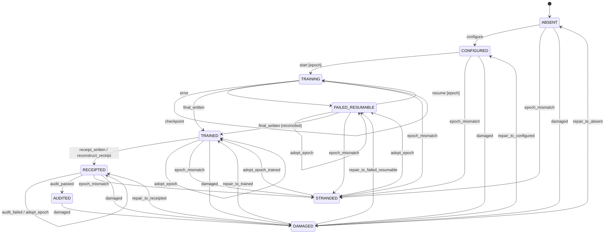

# Owner-selected EMPF application default

The owner selected the released native EMPF preset after the completed ParticleGAN 0.10.0 comparison and requested that it become the default and be pushed. The application config is [`configs/microglia_default.json`](../../configs/microglia_default.json), and the public entrypoint is [`scripts/microglia.py`](../../scripts/microglia.py).

The selected model is the complete 20,000-update fold0/seed0 fit at `runs/empf_comparison_20261117/fits/native/pbulk/hvg2000/fold0/seed0`. It trained on 25 of the 37 development donors; 12 donors were held out. This is the retained pilot model, with no full-cohort refit. Its eight weight files, metadata and every-step regularization audit are bound in [`selected_model.json`](selected_model.json). All 20,000 updates applied the regularizer (`lazy_k=1`).

This is an **owner-selected experimental default**. Native EMPF improves profile RMSE and both interval scores against the previous default in one fixed fold/seed. Gene errors and coverage regress, empirical resampling still wins both interval scores, and prospective population/default qualification did not pass. The [selection record](selection.json) preserves these distinctions; no old score, grade or confirmation result was changed.

The final public CLI generation reproduced the scored native pilot archive byte for byte. All 46 automated tests passed. The [verification record](verification.json), [generation receipt](application_generation.receipt.json) and [independent application review](independent_application_review.json) bind the selected model, cache payloads and current runtime sources.

## Use the completed model

In the recorded research environment with development caches available:

```bash
PY=/mnt/nvme/ai/conda/anaconda3/bin/python3
$PY -B scripts/microglia.py config
$PY -B scripts/microglia.py generate --dry-run
$PY -B scripts/microglia.py generate
```

The default generation command selects the retained native EMPF model and writes to `runs/microglia_empf/generated/selected/fold0/seed0/`. Newly trained fits generate into `runs/microglia_empf/generated/fold{f}/seed{s}/`, so a fold0/seed0 retrain never shares an output with the retained model. `--fit-source trained` generates from the newly trained fit at the selected fold/seed, and `--fit` explicitly selects another compatible, complete native EMPF fit, with matching `--fold` and `--seed`. Dry runs and real runs print the chosen fit and output. An existing output or receipt is refused before any work starts; `--force` replaces both, and only after the new output passes its checks: the receipt and then the NPZ are each replaced atomically, so the previous pair stays in place until then. The NPZ appears only after its receipt is written. If a run is interrupted between those two steps, a receipt without an NPZ remains; a rerun refuses it, and `--force` recovers. Hidden staging files (`.<stem>.pending.npz` and the generator's sidecars) are removed whether the run succeeds or fails. Supply `--out /path/outside/the/fit/generated.npz` for another output. Frozen cache payloads, recipe/version/regularizer audits and all checkpoint hashes are checked before inference. Receipts bind the starting source manifest, and changes during execution are rejected. The separately tested RHBI-matched EMPF variant is rejected.

The six late states, `cellshape@0.5:biascal:stagehalf` readout, training-only calibration, 32 generated donors per target, 256 cells per donor and named generation streams match the completed native EMPF pilot. `--profile count-shape` explicitly selects that same readout. `--profile profile-rmse` selects the bias-only alternative on EMPF; old BISPF results do not qualify this alternative.

## Train or resume

```bash
CUDA_VISIBLE_DEVICES=1 $PY -B scripts/microglia.py train --fold 0 --seed 0 --device cuda --dry-run
CUDA_VISIBLE_DEVICES=1 $PY -B scripts/microglia.py train --fold 0 --seed 0 --device cuda
```

Training uses fresh weights or its own compatible resume state under `runs/microglia_empf/fits/`, then generates outside the fit directory. `train` on a fit that is already complete and audited skips straight to generation. It preserves the selected pilot. A completed newly trained fit can be selected explicitly with `--fit`; the committed default model pointer continues to name the retained pilot. CPU threads/affinity are limited to three and GPU allocation to 4%. On a shared host each process claims a free block of three CPUs (preferring idle ones) under a machine-wide lock in `/tmp/microglia-cpu-slots-<uid>`; an inherited mask of three or fewer CPUs is kept, and `MICROGLIA_CPU_SLOT=k` selects the k-th block (an out-of-range k is an error, not wrapped). The slot locks are per user and per `/tmp`; jobs of other users, or with an isolated `/tmp`, do not take part and are avoided only through the measured CPU load. Receipts record the CPUs used. Set `CUDA_VISIBLE_DEVICES` explicitly when using CUDA. No GPU scheduler admission is required.

### Fit states

Each fit directory has an explicit state in `fit_state.json` (format `durable_state/1`), with every transition appended to `fit_state.json.journal.jsonl`. The state file is always written last, after the files it describes. `scripts/microglia_runtime.py train` holds an exclusive lock on `<fit>/fit.lock` across training, receipt and audit. A second process on the same fold/seed exits **75** (`EX_TEMPFAIL`) and names the owner pid, so two trainers can never write one fit. `train` on an `AUDITED` fit re-verifies it (`check_fit` and every checkpoint digest), does nothing else and exits **3**; if the files no longer verify it records `DAMAGED` and exits **4**. `scripts/microglia.py` treats 3 as success, reports 75 as busy (and exits 75) and reports 4 as a damaged fit. It skips the training step only when the fit has no `fit_state.json` or records `AUDITED`.

| State | Files | Leaves by |
| --- | --- | --- |
| `ABSENT` | none | `configure` (config.json written) |
| `CONFIGURED` | config.json | `start`, guarded: train_start.json absent or recording the live source-manifest digest (the epoch); train_start.json is written first when absent |
| `TRAINING` | + checkpoints | `checkpoint` (stays), `error`, `final_written` |
| `FAILED_RESUMABLE` | recovery.pt and/or failure.json | `resume`, guarded: the start epoch equals the live epoch; `final_written` when final.pt already landed |
| `TRAINED` | final.pt, no fit_receipt.json | `receipt_written`, or `reconstruct_receipt` |
| `RECEIPTED` | + fit_receipt.json | `audit_passed` / `audit_failed` (stays, reason journaled) |
| `AUDITED` | + no_skip_audit.json, check_fit and check_weights pass | only `damaged` (no terminal state) |
| `STRANDED` | epoch mismatch | only an explicit `--adopt-epoch` (`adopt_epoch` / `adopt_epoch_trained`) |
| `DAMAGED` | the files no longer support the recorded state | only an explicit `--repair` (`repair_to_<state>`, the state the files support) |



Any state before `AUDITED` moves to `STRANDED` when its start epoch, or the digest in an existing no_skip_audit.json, differs from the live manifest. A refreeze during a fit therefore strands it with a printed reason instead of resuming or relabelling it. `--adopt-epoch` journals an explicit adoption of the live epoch, and the audit lists it under `epoch_adoptions`. A pre-pinning fit with no `train_start.json` and either `recovery.pt` (`FAILED_RESUMABLE`) or `final.pt` (`TRAINED`, `RECEIPTED`) has an unknown epoch, so its resume or audit is refused unless `--adopt-epoch` is given; the audit then carries `training_start_note` and `epoch_adoptions`.

The audit runs in this order: `check_fit` passes on a staged copy that includes the new audit; `no_skip_audit.json` is written (an earlier, different audit is kept as `no_skip_audit.superseded.<sha12>.json`); `check_fit` passes on the fit itself; then the state becomes `AUDITED`. A process that died while `TRAINING` is recorded as `error` by the next run, which holds the lock. Files written after the last state write are caught up (`final_written`, `receipt_written`) before anything else happens. A run that died between writing `no_skip_audit.json` and the `AUDITED` state is caught up as `audit_passed` (journaled with `reconciled: true`) when that audit records this fit's own epoch and the live one, and `check_fit` and every checkpoint digest still pass; the same applies after an `audit_failed` that followed an earlier passing audit. Every event the trainer reports after a file lands (`checkpoint`, `final_written`, `receipt_written`, `reconstruct_receipt`, `error`) is best-effort: if recording it fails (ENOSPC, EIO), the trainer goes on and the runtime reconciles the state from the files. Under the lock, temp files of dead writers are swept, and a `recovery.pt` left beside a `final.pt` that a receipt verifies is removed.

**Exit codes of `microglia_runtime.py train`:** 0 trained/receipted/audited now; 1 error (reason printed); 3 already `AUDITED` and verified; 4 `DAMAGED` (rerun with `--repair` after inspecting); 75 another process holds the fit.

**Repair and reset.** `DAMAGED` is recorded when the state is ahead of the files: an `AUDITED` fit that no longer passes `check_fit`/`check_weights` (a deleted `no_skip_audit.json`, `fit_receipt.json` or `final.pt`, a changed snapshot), a `TRAINED`/`RECEIPTED` fit missing `final.pt` or its receipt, or an `ABSENT`/`CONFIGURED` fit that already has `final.pt`. `generate` refuses it. `train --repair` moves it, journaled, to the state its files support (`RECEIPTED` → re-audit, `TRAINED` → receipt reconstruction, `FAILED_RESUMABLE` → resume, `CONFIGURED`/`ABSENT` → fresh training) and continues; epoch checks still apply. A damaged `fit_state.json` or journal (truncated, unknown state, journal ahead of the state, or a deleted state file with its journal kept) fails closed with `CorruptState`. After inspecting the fit, `train --readopt` moves both to `fit_state.json.superseded.<utc>` and `fit_state.json.journal.jsonl.superseded.<utc>` and adopts the directory again from its files under the lock; doing the same by hand (move both files aside, never only the state file) is equivalent.

The trainer-side changes are derivation patches in [`vendored_host.py`](vendored_host.py) (`FIT_LIFECYCLE_PATCHES`), so the pinned round-5 `trainer.py` and `generate.py` stay byte-identical. The derived trainer reports its events to the runtime through a `FIT_EVENTS` hook. `checkpoint_receipt.json` is written before a checkpoint is renamed into place, and temp names carry the pid. When `final.pt` exists without `fit_receipt.json` (a crash before the receipt), the generation-only branch now rebuilds the receipt instead of returning silently. When `checkpoint_receipt.json` names `final.pt` it must carry its sha256 and the full update count; when it names another checkpoint (a later `recovery.pt` superseded it) or is missing, `final.pt`'s own header must be a completed checkpoint at the full update count. The rebuilt receipt is stamped `reconstructed: true` with its `basis`, `failure.json` is renamed to `failure.resolved.json`, and a `recovery.pt` beside the verified `final.pt` is removed. A failure after `final.pt` was renamed into place no longer writes `recovery.pt` over its checkpoint receipt. The derived generator adds `generated: true` and no longer rewrites a fit receipt's status to `completed`, so `training_completed` holds on every path.

`train --dry-run` on an existing fit directory takes the lock, adopts the fit and prints its state, its epochs and the allowed events; on a fit directory that does not exist it creates nothing and prints the state it would be adopted as. `generate` reads `fit_state.json` without locking or reconciling it (nothing is written into the fit) and refuses a fit that records anything but `AUDITED`; fits without a state file rely on `check_fit` as before.

**Migration.** Existing fit directories have no `fit_state.json`. The first runtime touch, including `--dry-run`, takes the lock and adopts the directory with a read-only reader: no files → `ABSENT`; config.json only → `CONFIGURED`; recovery.pt → `FAILED_RESUMABLE` at the step of a matching checkpoint receipt (start epoch from train_start.json, or none); final.pt without a receipt → `TRAINED`; a receipt with status `training_completed` or `completed` (written by the native generator) → `RECEIPTED`; and a passed no_skip_audit.json → `AUDITED` if `check_fit` passes, otherwise `RECEIPTED` with the reason recorded. Adoption writes only `fit_state.json`, its journal and lock files. No existing `config.json`, `final.pt`, `recovery.pt`, `fit_receipt.json` or `no_skip_audit.json` byte changes, except through journaled transitions in a non-dry run: `reconstruct_receipt` creates a `fit_receipt.json` where none existed, `failure.json` is renamed to `failure.resolved.json`, a superseded `recovery.pt` beside a verified `final.pt` is removed, and an audit writes `no_skip_audit.json` (keeping a different earlier one as `no_skip_audit.superseded.<sha12>.json`). Fits audited before this change are adopted as `AUDITED` and are never relabelled; `train` on them exits 3 as long as they verify.

## Runtime setup

The root `pyproject.toml` installs the older synthetic smoke experiment. It is not the environment recipe for human microglia. Use the recorded dependencies in [`runtime_environment.json`](../improve_20261109/runtime_environment.json), and the cache/model dependencies described in the [original study protocol](../improve_20261109/PROTOCOL.md). On a fresh environment, install the exact native release into its isolated target:

```bash
$PY -m pip install --no-deps --no-compile \
  --target artifacts/native-releases/particlegan-0.10.0/site-packages \
  'particlegan @ git+https://github.com/HyperGAN/ParticleGAN.git@952c3b62ba434f7da194067923351ff5748ef8dd'
```

This command is for an empty target on a fresh setup; this workspace already contains the verified release. The loader checks the imported version/origin and pinned native source hashes. Research caches and checkpoints remain local artifacts, as in the repository's existing contract. Git contains the config, source, metadata hashes and evidence, rather than patient cells or binary weights. `config` and `--dry-run` remain available without Torch, data or checkpoints.

### Model sources in the repository

The generator, critic and data helpers that the runtime imports used to be read from two absolute directories under `/ml2/codex-storage`. Six of them are now [vendored](vendored/) byte for byte: `pg_model.py`, `critic.py`, `usage.py`, `contracts.py`, `stage_law.py` and `bench_core.py`. [`vendored/SOURCES.json`](vendored/SOURCES.json) records each original path, size, modification time and sha256. The first three keep the digests they were pinned with. The last three were imported at runtime but had never been pinned, and they are now added to the manifest. An import trace of a CPU generation showed only these six files being loaded from `/ml2/codex-storage`. None of the six carries a license header; they are assumed to be covered by the repository license, which the owner should confirm.

[`vendored_host.py`](vendored_host.py) derives the native host the same way as the concluded study's [`host.py`](../empf_comparison_20261117/host.py), which stays unchanged because its study manifest pins it. It reuses that host's rewrites and adds five location rewrites, so that every location the derived files name is in the current checkout: `MODEL`, `SCIENCE`, `BENCH` and `RUNS` in the trainer, `SITE` in `release_env.py`, and `B` in a derived `contracts.py` (the released model adapter puts `contracts.B` first on `sys.path`). The model code does not change; only where it is imported from, plus the fit-lifecycle patches described under *Fit states*.

The derived files go to a versioned directory, `artifacts/native-releases/particlegan-0.10.0/alz-host-empf-native-vendored-<sha12>/`, where `<sha12>` begins the sha256 of every derivation input (the derived bodies, the vendored digests and the deriving sources). `derivation.json` is written last and is the commit marker; each `derived_sha256` in it is computed from the bytes written. The directory is `ABSENT`, `DERIVING` (exclusive lock held, temps), `DERIVED` (marker present, every digest matches) or `CORRUPT` (marker missing, or a file that does not match). Loading holds a shared lock on `<dir>.lock` and deriving an exclusive one, so concurrent processes load intact files and exactly one derives. `vendored_host.write_host` takes the lock itself, so direct callers are serialized too. A `CORRUPT` directory is rederived under the lock, and only when it belongs to the requested derivation. A refreeze that changes any input yields a new directory; the old one stays, so in-flight processes and earlier epochs keep loading their own host, and the old "existing derived EMPF host differs" dead end is gone. The unversioned `alz-host-empf-native-vendored/` written by the previous runtime, and the earlier `alz-host-empf-native/`, are never written; the unversioned directory is loaded read-only, as `DERIVED`, only if its files are byte-identical to the requested derivation, and pre-merge checkouts keep using it.

### Local artifacts the runtime still needs

These are gitignored and are not fetched by any script:

| Path | Needed for | Checked by |
| --- | --- | --- |
| `artifacts/native-releases/particlegan-0.10.0/site-packages/` | every run (imported) | release pin and runtime manifest |
| `artifacts/native-releases/particlegan-0.9.7/site-packages/` | the manifest check only (pinned, not imported) | runtime manifest |
| `runs/improve_20261109/caches/hvg2000/fold{f}/` | `train` and `generate` | `analysis/empirical_challenge_20261114/cache_and_fit_anchors.json` |
| `runs/empf_comparison_20261117/fits/native/pbulk/hvg2000/fold0/seed0/` | `generate` from the selected model | [`selected_model.json`](selected_model.json) and the fit receipts |

`artifacts/` must be a real directory that belongs to this checkout. Do not share it between checkouts or reach it through a symlink: the derived host files name this checkout's absolute paths, so a second checkout writing into a shared `artifacts/` is refused with "existing derived EMPF host differs", and `release_env` compares the resolved `particlegan` path with the unresolved `SITE` path, so a symlinked `artifacts/` fails its import-origin check.

The derived host directory is created on first use. In a checkout without these artifacts the manifest check reports the native releases as missing, and `train`/`generate` stop before any work starts.

## Historical source preservation

The previous 0.9.7 config remains unchanged at [`analysis/improve_20261109/default_config.json`](../improve_20261109/default_config.json). The previous public CLI is archived byte for byte in [`previous/microglia.py`](previous/microglia.py), with the old config also copied alongside it. Original 326/330/345-source manifests, training/evaluation code and receipts are unchanged.

Those historical manifests included a nonexecuted guard requiring the public CLI/default to stay unchanged during their experiments. That guard now correctly rejects the later owner-selected application CLI. For an exact historical rerun use source commit `77b2d7d`. The current runtime's [source manifest](runtime_source_manifest.json) checks the unchanged model/native sources, the archived old CLI and the new application config/entrypoints. It does not silently rewrite old pins or claim that new selection passed old promotion gates.

## Re-pinning the runtime sources

After an intended change to a pinned source, re-pin with `scripts/refreeze_runtime_manifest.py --reason '...'`. The tool keeps the pinned key set (missing files are an error, never dropped), archives the previous manifest under `previous/`, and records the reason and changed keys. `--check` verifies the checkout without writing. In a worktree without the gitignored native releases, `--artifact-root /path/to/main/checkout` reads those files from there; they must keep their pinned digests.
