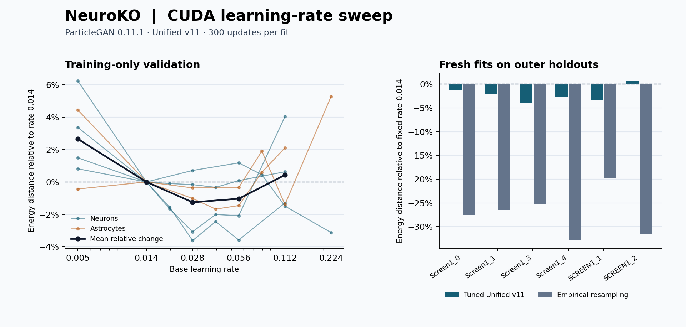

# CUDA learning-rate sweep for ParticleGAN 0.11.1

The experiment tunes `unified_v11` on the same four-target, 60,000-cell input as the [CPU release comparison](neuroko_particlegan_0111.md). The generator, critic, particle prior and training batches run on NVIDIA RTX A6000 GPUs. Sparse data preparation, PCA and the energy-distance readout run on CPU. The public 0.11.1 wheel and the pilot H5AD digests are recorded in the [release comparison](neuroko_particlegan_0111.json).

## Training-only validation

| Base learning rate | Mean validation energy distance ↓ |
|---:|---:|
| 0.005 | 1.3947 |
| 0.014 (published) | 1.3588 |
| **0.028** | **1.3439** |
| 0.056 | 1.3486 |
| 0.112 | 1.3673 |

A base rate of **0.028** was the best single setting among rates compared on all six folds. It lowered mean validation energy distance by 1.1% relative to 0.014. Adjacent settings are close, and the fold-local winners vary. The value applies to the fixed 300-update pilot schedule.

## Selection and confirmation

Each of the four neuronal replicates and two astrocyte sequencing batches serves as an outer holdout once. For neuronal rate selection, the next replicate in cyclic order supplies validation cells within the training set. For astrocytes, the single training batch is divided by whole guide vectors within each condition. The exact vector subset is chosen using cell counts alone, near one third of each condition, with at least 16 validation and 32 fitting cells. Features, PCA and scaling are fitted only on the matching fitting rows.

The starting grid was 0.005, 0.014, 0.028, 0.056 and 0.112. Each candidate is freshly trained for 300 updates with validation seed 0. Each fold then checks two rates halfway to the neighboring coarse rates on a log scale, centered on that fold's coarse winner. At a grid boundary the search also adds one rate beyond the grid, at half or twice the boundary rate. Refinement uses the same inner validation split. Average energy distance over the four validation targets is the selection metric. The same base-rate setting applies to the published recipe's existing critic and prior learning-rate multipliers. The network, schedule horizon, number of particles, batch size and latent dimension match the earlier pilot settings.

After a fold selects its rate from training validation, both the selected rate and the published base rate of 0.014 are fitted from scratch using all available outer-training rows. A matched empirical resampling baseline uses the same rows and scoring split. Confirmation uses seeds 1 and 2. The outer-group results estimate the procedure that selects a rate independently for each fold. A pooled candidate selected across all inner validations is a practical rate for this panel. Its pooled selection score does not provide a separate external validation of that single rate.

## Outer holdout results

The chart compares validation rates and the two-seed outer holdout means. Dashed lines mark the published rate's energy distance in each comparison.



| Held-out cells | Published 0.014 ↓ | Fold-local rate ↓ | Empirical resampling ↓ |
|---|---:|---:|---:|
| Neurons | 1.4689 | 1.4343 | 1.0515 |
| Astrocytes | 1.9833 | 1.9590 | 1.4701 |
| All groups | 1.6404 | 1.6092 | 1.1911 |

The fold-local tuning procedure lowered mean held-out energy distance by 1.9%. It beat 0.014 on 39 of 48 paired target, group and seed comparisons and beat empirical resampling on 0 of 48. The tuned fits had an average spread ratio of 0.65 and mean shift cosine of -0.007.

| Outer group | Selected base rate | Published 0.014 ↓ | Selected rate ↓ | Empirical resampling ↓ |
|---|---:|---:|---:|---:|
| `Screen1_0` | 0.224 | 1.7927 | 1.7687 | 1.2990 |
| `Screen1_1` | 0.028 | 1.3495 | 1.3220 | 0.9920 |
| `Screen1_3` | 0.0396 | 1.0610 | 1.0193 | 0.7933 |
| `Screen1_4` | 0.028 | 1.6725 | 1.6274 | 1.1217 |
| `SCREEN1_1` | 0.0396 | 1.9144 | 1.8520 | 1.5372 |
| `SCREEN1_2` | 0.112 | 2.0521 | 2.0660 | 1.4031 |

`Screen1_0` selected 0.224 at its local upper boundary. That fold's optimum could be beyond the values tested. In total, 66 CUDA fits ran 19,800 updates. A machine-readable [summary](neuroko_particlegan_0111_gpu_lr.json) includes the validation splits and scores for each fold.

## Matched CUDA comparison with 0.10.0

The 0.10.0 EMPF arm uses the earlier NeuroKO base rate of 0.005. Both releases used the same RTX A6000 model, 300 updates, six outer holdouts, four targets and seeds 1 and 2. Empirical samples and their scores matched exactly in every replay. The fixed 0.028 arm reuses the confirmation fits on `Screen1_1` and `Screen1_4`, which had selected that rate. The fixed replay describes the pooled validation recommendation. The fold-tuned arm selects each rate using only its own outer training data.

| Model and base rate | Neuron energy ↓ | Astrocyte energy ↓ | All groups energy ↓ | Mean shift cosine ↑ | Mean absolute spread error ↓ |
|---|---:|---:|---:|---:|---:|
| 0.10.0 EMPF, 0.005 | 1.2904 | 1.6669 | 1.4159 | 0.015 | 0.370 |
| 0.11.1 Unified v11, fixed 0.028 | 1.4379 | 1.9349 | 1.6036 | -0.001 | 0.352 |
| 0.11.1 Unified v11, fold-tuned | 1.4343 | 1.9590 | 1.6092 | -0.007 | 0.353 |
| Empirical resampling | 1.0515 | 1.4701 | 1.1911 | -0.021 | 0.201 |

Relative to 0.10.0 EMPF, mean energy distance was 13.3% higher at fixed 0.028 and 13.7% higher with fold-specific tuning. Fixed 0.028 beat EMPF on 12 of 48 paired rows. Fold-specific tuning beat it on 13 of 48. The rows share experimental groups and are descriptive. [Machine-readable comparison](neuroko_cuda_010_vs_0111.json)

## Reproduce

Use a CUDA-enabled paper-watch environment with the verified 0.11.1 wheel and the pilot H5ADs in `paper_watch/data/neuroko/pilot`. Run the same stages for `Screen1_0`, `Screen1_1`, `Screen1_3`, `Screen1_4`, `SCREEN1_1` and `SCREEN1_2`.

```sh
CUDA_VISIBLE_DEVICES=0 OPENBLAS_NUM_THREADS=2 OMP_NUM_THREADS=2 \
  python -m paper_watch.alztest.neuroko_lr validation \
  --data paper_watch/data/neuroko/pilot --output paper_watch/data/neuroko/lr-cuda \
  --group Screen1_0

CUDA_VISIBLE_DEVICES=0 OPENBLAS_NUM_THREADS=2 OMP_NUM_THREADS=2 \
  python -m paper_watch.alztest.neuroko_lr refine \
  --data paper_watch/data/neuroko/pilot --output paper_watch/data/neuroko/lr-cuda \
  --group Screen1_0

CUDA_VISIBLE_DEVICES=0 OPENBLAS_NUM_THREADS=2 OMP_NUM_THREADS=2 \
  python -m paper_watch.alztest.neuroko_lr heldout \
  --data paper_watch/data/neuroko/pilot --output paper_watch/data/neuroko/lr-cuda \
  --group Screen1_0 --seed 1
```

Repeat the held-out command with `--seed 2`. Multiple `--group` flags allow a single process to run several folds. Each completed group writes a separate JSON receipt with the chosen rate, device, split and per-target scores.

For the version replays, use the matching release wheel and the same data, groups and seeds. Append `--group` for each of the six groups and repeat with `--seed 2`.

```sh
# In the 0.10.0 environment.
CUDA_VISIBLE_DEVICES=0 OPENBLAS_NUM_THREADS=2 OMP_NUM_THREADS=2 \
  python -m paper_watch.alztest.neuroko_lr replay \
  --data paper_watch/data/neuroko/pilot --output paper_watch/data/neuroko/lr-cuda/version-replays \
  --group Screen1_0 --recipe empf --rates 0.005 --seed 1

# In the 0.11.1 environment.
CUDA_VISIBLE_DEVICES=0 OPENBLAS_NUM_THREADS=2 OMP_NUM_THREADS=2 \
  python -m paper_watch.alztest.neuroko_lr replay \
  --data paper_watch/data/neuroko/pilot --output paper_watch/data/neuroko/lr-cuda/version-replays \
  --group Screen1_0 --recipe unified_v11 --rates 0.028 --seed 1
```
