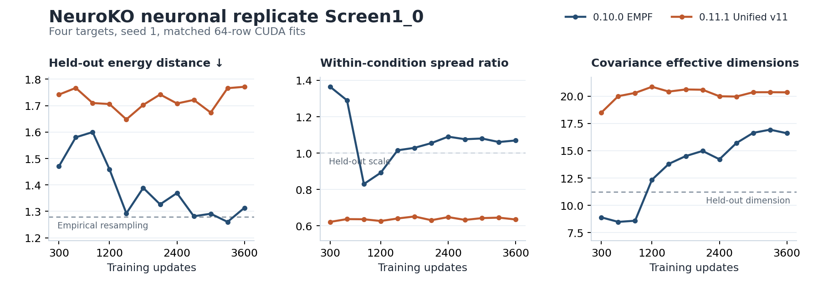

# CUDA learning-rate sweep for ParticleGAN 0.11.1

The experiment tunes `unified_v11` on the same four-target, 60,000-cell input as the [CPU release comparison](neuroko_particlegan_0111.md). The generator, critic, particle prior and training batches run on NVIDIA RTX A6000 GPUs. Sparse data preparation, PCA and the energy-distance readout run on CPU. The public 0.11.1 wheel and the pilot H5AD digests are recorded in the [release comparison](neuroko_particlegan_0111.json).

## Training-only validation

| Base learning rate | Mean validation energy distance ↓ |
|---:|---:|
| 0.005 | 1.3947 |
| 0.014 (published) | 1.3588 |
| **0.028** | **1.3439** |
| 0.056 | 1.3486 |
| 0.112 | 1.3673 |

A base rate of **0.028** was the best single setting among rates compared on all six folds. It lowered mean validation energy distance by 1.1% relative to 0.014. Adjacent settings are close, and the fold-local winners vary. The value applies to the fixed 300-update pilot schedule.

## Selection and confirmation

Each of the four neuronal replicates and two astrocyte sequencing batches serves as an outer holdout once. For neuronal rate selection, the next replicate in cyclic order supplies validation cells within the training set. For astrocytes, the single training batch is divided by whole guide vectors within each condition. The exact vector subset is chosen using cell counts alone, near one third of each condition, with at least 16 validation and 32 fitting cells. Features, PCA and scaling are fitted only on the matching fitting rows.

The starting grid was 0.005, 0.014, 0.028, 0.056 and 0.112. Each candidate is freshly trained for 300 updates with validation seed 0. Each fold then checks two rates halfway to the neighboring coarse rates on a log scale, centered on that fold's coarse winner. At a grid boundary the search also adds one rate beyond the grid, at half or twice the boundary rate. Refinement uses the same inner validation split. Average energy distance over the four validation targets is the selection metric. The same base-rate setting applies to the published recipe's existing critic and prior learning-rate multipliers. The network, schedule horizon, number of particles, batch size and latent dimension match the earlier pilot settings.

After a fold selects its rate from training validation, both the selected rate and the published base rate of 0.014 are fitted from scratch using all available outer-training rows. A matched empirical resampling baseline uses the same rows and scoring split. Confirmation uses seeds 1 and 2. The outer-group results estimate the procedure that selects a rate independently for each fold. A pooled candidate selected across all inner validations is a practical rate for this panel. Its pooled selection score does not provide a separate external validation of that single rate.

## Outer holdout results

The chart compares validation rates and the two-seed outer holdout means. Dashed lines mark the published rate's energy distance in each comparison.


| Held-out cells | Published 0.014 ↓ | Fold-local rate ↓ | Empirical resampling ↓ |
|---|---:|---:|---:|
| Neurons | 1.4689 | 1.4343 | 1.0515 |
| Astrocytes | 1.9833 | 1.9590 | 1.4701 |
| All groups | 1.6404 | 1.6092 | 1.1911 |

The fold-local tuning procedure lowered mean held-out energy distance by 1.9%. It beat 0.014 on 39 of 48 paired target, group and seed comparisons and beat empirical resampling on 0 of 48. The tuned fits had an average spread ratio of 0.65 and mean shift cosine of -0.007.

| Outer group | Selected base rate | Published 0.014 ↓ | Selected rate ↓ | Empirical resampling ↓ |
|---|---:|---:|---:|---:|
| `Screen1_0` | 0.224 | 1.7927 | 1.7687 | 1.2990 |
| `Screen1_1` | 0.028 | 1.3495 | 1.3220 | 0.9920 |
| `Screen1_3` | 0.0396 | 1.0610 | 1.0193 | 0.7933 |
| `Screen1_4` | 0.028 | 1.6725 | 1.6274 | 1.1217 |
| `SCREEN1_1` | 0.0396 | 1.9144 | 1.8520 | 1.5372 |
| `SCREEN1_2` | 0.112 | 2.0521 | 2.0660 | 1.4031 |

`Screen1_0` selected 0.224 at its local upper boundary. That fold's optimum could be beyond the values tested. In total, 66 CUDA fits ran 19,800 updates. A machine-readable [summary](neuroko_particlegan_0111_gpu_lr.json) includes the validation splits and scores for each fold.

## Matched CUDA comparison with 0.10.0

The 0.10.0 EMPF arm uses the earlier NeuroKO base rate of 0.005. Both releases used the same RTX A6000 model, 300 updates, six outer holdouts, four targets and seeds 1 and 2. Empirical samples and their scores matched exactly in every replay. The fixed 0.028 arm reuses the confirmation fits on `Screen1_1` and `Screen1_4`, which had selected that rate. The fixed replay describes the pooled validation recommendation. The fold-tuned arm selects each rate using only its own outer training data.

| Model and base rate | Neuron energy ↓ | Astrocyte energy ↓ | All groups energy ↓ | Mean shift cosine ↑ | Mean absolute spread error ↓ |
|---|---:|---:|---:|---:|---:|
| 0.10.0 EMPF, 0.005 | 1.2904 | 1.6669 | 1.4159 | 0.015 | 0.370 |
| 0.11.1 Unified v11, fixed 0.028 | 1.4379 | 1.9349 | 1.6036 | -0.001 | 0.352 |
| 0.11.1 Unified v11, fold-tuned | 1.4343 | 1.9590 | 1.6092 | -0.007 | 0.353 |
| Empirical resampling | 1.0515 | 1.4701 | 1.1911 | -0.021 | 0.201 |

Relative to 0.10.0 EMPF, mean energy distance was 13.3% higher at fixed 0.028 and 13.7% higher with fold-specific tuning. Fixed 0.028 beat EMPF on 12 of 48 paired rows. Fold-specific tuning beat it on 13 of 48. The rows share experimental groups and are descriptive. [Machine-readable comparison](neuroko_cuda_010_vs_0111.json)

## Released default and NeuroKO overrides

The 0.11.1 wheel resolves `get_recipe()` and `get_recipe("unified_v11")` to the same recipe. All 170 non-name fields in the released Forge configuration match the installed preset. The NeuroKO CUDA path passes the preset to the public `GANTrainer`. It retains `UnifiedV11GANLoss`, `UnifiedV11CriticPenalty`, `UnifiedV11PriorRegularizer` and `UnifiedV11EquilibratedOptimizer` for both the critic and generator/particle optimizer. The critic takes a single expression tensor, and the harness supplies the same categorical one-hot condition inside G and D. This uses the scalar-vector GAN path. The separate continuous-context fiber bank is outside this experiment. [0.11.1 release](https://github.com/HyperGAN/ParticleGAN/releases/tag/v0.11.1) · [Forge configuration](https://github.com/HyperGAN/ParticleGAN/blob/d5dec2fe005305082acf382f0939a4bdb51c7131/configs/forge/ideas/unified-v11.json) · [Trainer source](https://github.com/HyperGAN/ParticleGAN/blob/d5dec2fe005305082acf382f0939a4bdb51c7131/particlegan/training.py)

A five-update CUDA trace on the neuronal fold verified that the forward-AD penalty ran, the loss captured the real and fake tensors, and the generator, critic and prior parameters all changed. At a fixed sample seed, changing the condition changed the generated expression. NeuroKO uses 30 expression coordinates. The release gates the specialized prior pullback for point masses and continuous kernels to at most 16 output coordinates. [Prior source](https://github.com/HyperGAN/ParticleGAN/blob/d5dec2fe005305082acf382f0939a4bdb51c7131/particlegan/_unified_v11/prior.py) · [Trace results](neuroko_cuda_duration.json)

| Setting | 0.11.1 default | Tuned NeuroKO replay |
|---|---:|---:|
| Generator LR | 0.014 | 0.028 |
| Critic LR | 0.021 | 0.042 |
| Particle LR | 0.0406 | 0.0812 |
| Batch size | 2,048 | 64 |
| Trainable particles | 20,000 | 64 |
| Latent dimensions | 2 | 16 |
| Added Gaussian prior noise | None | σ = 0.025 |

The sweep multiplied the base rate by the stock critic factor of 1.5 and particle factor of 2.9. Neither multiplier was tuned independently. Both `lr_floor` and `network_lr_floor` are 1.0, so the cosine schedule leaves all three rates constant. The replay reads these rates from the optimizer groups at initialization and at each checkpoint. The published-rate arm in the earlier sweep uses 0.014 with the smaller NeuroKO settings. [Recipe source](https://github.com/HyperGAN/ParticleGAN/blob/d5dec2fe005305082acf382f0939a4bdb51c7131/particlegan/recipes.py)

## 1,200-update CUDA replay

Seed 1 was replayed on the first neuronal replicate and the first astrocyte batch. Each pair uses the same physical RTX A6000, the same held-out cells and the same empirical draw. The fit time sums synchronized CUDA training segments. It includes the first update and excludes preprocessing, model construction, generating evaluation samples and scoring. GPU workload was shared and varied between runs. Each group ran the two recipes in the opposite order from the other group.

| Holdout | Recipe | Energy at 300 ↓ | At 600 ↓ | At 1,200 ↓ | Fit time |
|---|---|---:|---:|---:|---:|
| Neurons `Screen1_0` | 0.10.0 EMPF, 0.005 | 1.470 | 1.580 | 1.473 | 92.0 s |
| Neurons `Screen1_0` | 0.11.1 Unified v11, 0.028 | 1.742 | 1.767 | 1.706 | 136.3 s |
| Astrocytes `SCREEN1_1` | 0.10.0 EMPF, 0.005 | 1.795 | 1.716 | 1.548 | 293.4 s |
| Astrocytes `SCREEN1_1` | 0.11.1 Unified v11, 0.028 | 1.873 | 1.854 | 1.856 | 269.7 s |

EMPF had lower energy distance in both holdouts at all three checkpoints. Empirical resampling scored 1.278 for the neuronal replicate and 1.538 for the astrocyte batch. Unified v11 took 48% longer on GPU 0 for the neuronal pair and 8% less time on the busier GPU 1 for the astrocyte pair. The median times in the four earlier same-GPU 300-update pairs were 26.6 seconds for EMPF and 32.9 seconds for Unified v11. [Machine-readable duration results](neuroko_cuda_duration.json)

## Stock 0.11.1 on the neuronal fold

The unmodified preset ran on `Screen1_0` with seed 1 and the same conditioned MLPs. Each 2,048-row batch samples with replacement from 303–480 training cells of the current condition. The stock check ended at 600 updates.

| Updates | Stock v11 energy ↓ | Tuned v11 energy ↓ | EMPF energy ↓ | Stock v11 cumulative fit time |
|---:|---:|---:|---:|---:|
| 300 | 1.712 | 1.742 | 1.470 | 14.4 min |
| 600 | 1.594 | 1.767 | 1.580 | 33.1 min |

The stock preset's energy distance fell by 6.9% between 300 and 600 updates, and its spread ratio rose from 0.715 to 0.798. The configuration changes the optimizer rates, batch size, latent dimension, particle count and prior noise together. These results cover one fold. [Stock replay metrics](neuroko_cuda_duration.json)

## Neuronal convergence and spread through 2,400 updates

One additional replay on `Screen1_0` used seed 1 and scored every 300 updates. The two arms reproduced their earlier 300- and 600-update scores within 0.001%. The 1,200-update EMPF energy scores were 1.473 in the first replay and 1.453 in this longer replay. All values below describe the single longer run per recipe.

EMPF rose from 1.343 at 1,800 updates to 1.433 at 2,100, then reached its lowest energy distance of 1.319 at 2,400. Unified v11 reached 1.648 at 1,500 and ended at 1.708. At 2,400, Unified v11's within-target spread was 0.648× the held-out spread and EMPF's was 1.081×. Unified v11's variance was distributed across more effective dimensions (20.0 versus 15.4 for EMPF and 11.2 in the held-out data). The covariance participation ratio is the squared trace divided by the sum of squared covariance entries. It measures the number of directions sharing the variance. The spread ratio measures the square root of total generated variance divided by total observed variance.

The configured learning rates remained constant. The generator's checkpointed `ema_func_gain` ranged from 0.881 to 1.000 at the eight measured updates, and the critic's was 1.000 at each checkpoint. The generator's last-step gain was 0.840 at update 2,400. The optimizer applies a step-specific gain in addition to its configured rate. Below an `ema_func_gain` of 0.75 it also incorporates the EMA into the next generator step's scale before the displacement probe. [Optimizer source](https://github.com/HyperGAN/ParticleGAN/blob/d5dec2fe005305082acf382f0939a4bdb51c7131/particlegan/_unified_v11/optimizer.py) · [Checkpoint metrics and gains](neuroko_cuda_duration.json)

## Neuronal comparison at 3,600 updates

The 2,400-update runs saved scores only. Both releases were retrained from seed 1 on the same neuronal holdout with the same 64-row batches, prior, and learning rates as the preceding matched comparison. They ran on separate shared RTX A6000s. Energy distances are means across four targets.

| Updates | 0.10.0 EMPF ↓ | 0.11.1 tuned Unified v11 ↓ |
|---:|---:|---:|
| 2,400 | 1.369 | 1.708 |
| 2,700 | 1.281 | 1.722 |
| 3,000 | 1.291 | 1.674 |
| 3,300 | 1.260 | 1.766 |
| 3,600 | 1.314 | 1.771 |



EMPF had lower energy distance on all four targets at 3,600. Its mean rose from 1.260 at 3,300 to 1.314 at 3,600, finishing 25.8% below tuned Unified v11.

At 3,600 updates, the generated-to-observed spread ratio was 1.070 for EMPF and 0.635 for Unified v11. The covariance effective dimensions were 16.6 and 20.4, respectively, compared with 11.2 in the held-out cells. Empirical resampling scored 1.278 on energy distance. [Checkpoint and per-target results](neuroko_cuda_duration.json)

## Reproduce

Use a CUDA-enabled paper-watch environment with the verified 0.11.1 wheel and the pilot H5ADs in `paper_watch/data/neuroko/pilot`. Run the same stages for `Screen1_0`, `Screen1_1`, `Screen1_3`, `Screen1_4`, `SCREEN1_1` and `SCREEN1_2`.

```sh
CUDA_VISIBLE_DEVICES=0 OPENBLAS_NUM_THREADS=2 OMP_NUM_THREADS=2 \
  python -m paper_watch.alztest.neuroko_lr validation \
  --data paper_watch/data/neuroko/pilot --output paper_watch/data/neuroko/lr-cuda \
  --group Screen1_0

CUDA_VISIBLE_DEVICES=0 OPENBLAS_NUM_THREADS=2 OMP_NUM_THREADS=2 \
  python -m paper_watch.alztest.neuroko_lr refine \
  --data paper_watch/data/neuroko/pilot --output paper_watch/data/neuroko/lr-cuda \
  --group Screen1_0

CUDA_VISIBLE_DEVICES=0 OPENBLAS_NUM_THREADS=2 OMP_NUM_THREADS=2 \
  python -m paper_watch.alztest.neuroko_lr heldout \
  --data paper_watch/data/neuroko/pilot --output paper_watch/data/neuroko/lr-cuda \
  --group Screen1_0 --seed 1
```

Repeat the held-out command with `--seed 2`. Multiple `--group` flags allow a single process to run several folds. Each completed group writes a separate JSON receipt with the chosen rate, device, split and per-target scores.

For the version replays, use the matching release wheel and the same data, groups and seeds. Append `--group` for each of the six groups and repeat with `--seed 2`.

```sh
# In the 0.10.0 environment.
CUDA_VISIBLE_DEVICES=0 OPENBLAS_NUM_THREADS=2 OMP_NUM_THREADS=2 \
  python -m paper_watch.alztest.neuroko_lr replay \
  --data paper_watch/data/neuroko/pilot --output paper_watch/data/neuroko/lr-cuda/version-replays \
  --group Screen1_0 --recipe empf --rates 0.005 --seed 1

# In the 0.11.1 environment.
CUDA_VISIBLE_DEVICES=0 OPENBLAS_NUM_THREADS=2 OMP_NUM_THREADS=2 \
  python -m paper_watch.alztest.neuroko_lr replay \
  --data paper_watch/data/neuroko/pilot --output paper_watch/data/neuroko/lr-cuda/version-replays \
  --group Screen1_0 --recipe unified_v11 --rates 0.028 --seed 1
```

For a single fit scored at 300, 600 and 1,200 updates, use `neuroko_duration` with each release and its recipe and base rate. `--use-recipe-defaults` uses the preset's learning rate, dimensions, batch size and trainer-built prior. On the capped pilot, a 2,048-row batch draws with replacement from its current condition. G and D retain the same task-specific networks and conditioning wrapper.

```sh
# In the 0.11.1 environment.
CUDA_VISIBLE_DEVICES=0 OPENBLAS_NUM_THREADS=2 OMP_NUM_THREADS=2 \
  python -m paper_watch.alztest.neuroko_duration --data paper_watch/data/neuroko/pilot \
  --group Screen1_0 --recipe unified_v11 --rate 0.028 \
  --out paper_watch/data/neuroko/lr-cuda/duration/Screen1_0-unified_v11.json

# The same held-out fold with the published preset.
CUDA_VISIBLE_DEVICES=0 OPENBLAS_NUM_THREADS=2 OMP_NUM_THREADS=2 \
  python -m paper_watch.alztest.neuroko_duration --data paper_watch/data/neuroko/pilot \
  --group Screen1_0 --recipe unified_v11 --use-recipe-defaults \
  --checkpoints 1 10 300 600 \
  --out paper_watch/data/neuroko/lr-cuda/duration/Screen1_0-unified_v11-stock.json
```

For the longer neuronal replay, append `--checkpoints 300 600 900 1200 1500 1800 2100 2400 2700 3000 3300 3600` to the fixed-rate command. Use the separately installed 0.10.0 release with `--recipe empf --rate 0.005` for the EMPF replay. Choose a different output path for each fit.
