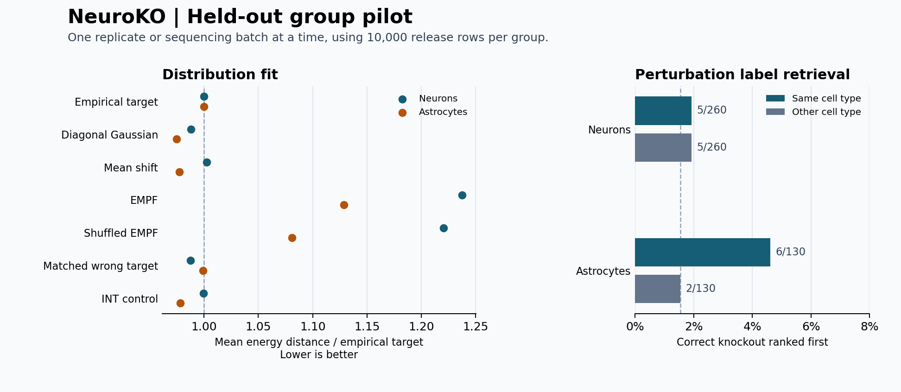

# NeuroKO perturbation benchmark

[PR #10](https://github.com/difflabai/alz-perturb-gan/pull/10) closed unmerged at iteration zero. The [Zenodo release](https://zenodo.org/records/23260389) now resolves and lists both processed count matrices under CC BY 4.0. The concept DOI is `10.5281/zenodo.23260388`. The analysis pins the file version `10.5281/zenodo.23260389`. The dataset accompanies the [Dominicus et al. preprint](https://doi.org/10.64898/2026.10.13.758778).

## Release coverage

| Screen | Cells | Genes | Holdout groups | Targets with ≥100 cells in every group | Targets with ≥2 vectors of ≥20 cells in every group |
|---|---:|---:|---|---:|---:|
| Induced neurons | 205,028 | 36,601 | 4 named replicates | 74 | 109 |
| Induced astrocytes | 195,306 | 36,601 | 2 sequencing batches | 195 | 198 |

The [release coverage audit](neuroko_release_coverage.json) records cell and vector counts per target and group. Each matrix has 250 observed gene targets and intergenic controls. All 74 targets that meet the 100-cell threshold in neurons also meet it in astrocytes. The neuronal object uses `perturbation` to aggregate the intergenic guides as `INT`, `target_vector` for construct identity, and `Replicate` for grouping. The astrocyte object uses `target_gene`, `guide_vector`, and `sequencing_batch`. The pilot pools cells with the released `INT` label. The authors' neuronal pseudobulk script excludes INT3 and INT30, so control-vector composition is a useful sensitivity for a replication. APP, SORL1 and BIN1 have at least 316, 263 and 171 cells respectively in every group across both screens, and each has at least two vectors with 20 cells per group. The group counts support a replicate-held-out neuronal benchmark and a sequencing-batch-held-out astrocyte benchmark. The [authors’ analysis code](https://github.com/Lotfollahi-lab/NeuroID-reproducibility) uses these same grouping fields for its pseudobulk analyses.

## Evaluation

- Hold out one complete group at a time. Choose shared targets by their minimum cell count across all groups, then cap the number sampled per target using the same cap within each screen. This favors well-covered targets and uses annotation coverage in the held-out groups. The benchmark estimates performance for that selected panel.
- Normalize raw counts per cell to 10,000, then apply `log1p`. Fit feature selection, PCA, and scaling once on training cells in each fold. Project held-out cells through that transform.
- Compare the fixed EMPF fit with shuffled-label EMPF, empirical resampling of the right target, mean shift from pooled training INT, a diagonal Gaussian, INT-only resampling, and a wrong-target arm matched on target-gene expression in training INT cells. The matched target comes from the evaluated panel and is reported for each fold.
- Use energy distance for distribution fit, cosine for the target-vs-INT mean shift, and the ratio of simulated to observed total standard deviation for spread. Treat fold and seed summaries as descriptive. Cells and seeds do not add independent experimental groups.
- Compare each held-out group's target-vs-INT profile with the same target from the remaining same-screen groups and from the other screen. Rank the correct target against wrong-target profiles in each reference set to check specificity. This diagnostic aligns exact, unique gene symbols and averages group profiles equally. It also repeats the comparison with the panel's perturbed genes removed from the expression profiles.
- Report target-gene expression and detection by vector relative to group-matched INT. Also compare each eligible withheld vector with the pooled other vectors of the same target in its group, using disjoint INT reference cells. This measures vector agreement within each group. An RNA readout alone cannot establish editing efficiency.

## Pilot results

The pilot uses the first 10,000 released rows of each group, for 40,000 neuronal and 20,000 astrocyte cells. These are contiguous release windows. The coverage audit above uses the complete annotations from both files. The pilot's coverage-ranked distribution panel had four targets with at least 100 cells per group. The broader profile comparison had 65 targets with at least 32 cells per group.



The [pilot summary](neuroko_pilot_summary.json) records the source row intervals, local slice digests, software versions, and arm-level results.

### Distribution fit with held-out groups

The panel was GLCCI1, SLC2A4RG, PLEKHA1 and MAMSTR. The run used 300 updates per EMPF fit, three seeds and all six outer group holdouts. Mean energy distance was calculated over target, holdout and seed comparisons within each screen.

| Arm | Neurons | Astrocytes |
|---|---:|---:|
| EMPF | 1.298 | 1.657 |
| Shuffled-label EMPF | 1.280 | 1.587 |
| Diagonal Gaussian | 1.036 | 1.431 |
| Empirical target resampling | 1.049 | 1.468 |
| Mean shift | 1.052 | 1.435 |
| Expression-matched wrong target | 1.036 | 1.467 |
| Intergenic controls | 1.048 | 1.436 |

EMPF had 24% higher mean energy distance than empirical target resampling in neurons and 13% higher in astrocytes. It beat that baseline in 1 of 72 target–holdout–seed comparisons and had higher mean distance than shuffled-label EMPF in both screens. Its mean shift cosine was −0.041 and −0.020, respectively. Mean-shift spread ratios were 1.24 and 1.16, compared with 1.36 and 1.38 for EMPF. At this budget the fit had weak target specificity and overestimated spread. Matched wrong-target profiles had energy distances close to the right-target empirical baseline, so energy distance alone does little to establish target identity in this panel.

### Target identity across groups and cell types

| Held-out destination | Rank 1 using same-cell-type references | Rank 1 using other-cell-type references | Median cosine, same cell type | Median cosine, other cell type |
|---|---:|---:|---:|---:|
| Neuronal replicate | 5 / 260 | 5 / 260 | 0.009 | 0.002 |
| Astrocyte sequencing batch | 6 / 130 | 2 / 130 | 0.013 | 0.006 |

These ranks were against 64 alternative targets. Uniform ranks would put the correct target first in 1 of 65 comparisons. The same-cell-type cosine beat the median wrong-target score in 161/260 neuronal and 81/130 astrocyte comparisons. Cross-cell-type scores beat that median in 140/260 and 70/130 comparisons. Removing the 65 panel targets from the expression features left the same-cell-type rank-1 counts intact and reduced cross-cell-type rank-1 counts to 4/260 and 1/130. Using all available cells of the same 65 targets and INT in the pilot windows raised the same-type rank-1 counts to 12/260 and 4/130. Cross-type rank-1 counts stayed low at 5/260 and 1/130. The comparisons share groups and controls and should be read descriptively.

APP is an example of why the outputs report direct target RNA and whole-profile agreement separately. Its average target-gene RNA was lower than group-matched INT in seven of eight eligible neuronal vector-by-replicate comparisons and all four eligible astrocyte vector-by-batch comparisons. The independent-reference comparison across vectors in the broader panel had median whole-profile cosine 0.006 in neurons and 0.007 in astrocytes.

## Reproduce

Run these commands from the repository root in the [paper-watch environment](../README.md).

```sh
python paper_watch/scripts/fetch_neuroko.py
python -m paper_watch.alztest.neuroko audit --out paper_watch/data/neuroko/audit.json
OPENBLAS_NUM_THREADS=2 python -m paper_watch.alztest.neuroko evaluate \
  --out paper_watch/data/neuroko/evaluation.json
python -m paper_watch.alztest.neuroko transfer --targets 100 --min-cells 100 \
  --out paper_watch/data/neuroko/transfer.json
```

The fetcher resumes partial files and checks each final byte count and Zenodo MD5 before promoting it to `.h5ad`. Both original files total 13.78 GB. The evaluation reads capped rows from backed sparse matrices. Use `--steps 0` for a baseline-only run or `--window-cells 10000` with the original files to reproduce the pilot windows. The pilot transfer run used `--targets 100 --min-cells 32 --cap 128`. The all-available-cell comparison used the same options with `--cap 10000 --use-available-cells`. Repeat `--target` for an explicit panel, for example `--target APP --target SORL1 --target BIN1` with the full files.

## Uses for both projects

- NeuroKO supplies ALZ Perturb GAN with genuine perturbation labels and vector annotations to test whether a conditional model recovers the specificity and spread of a knockout response across groups. The two cell types also make a test of how far perturbation effects transfer across cell identity. Prediction for a gene excluded from training would require a representation of gene identity that goes beyond the harness's one-hot labels, and a split that holds out the entire target. The pilot supports checking profile specificity within each cell type and comparing it with the empirical and mean-shift baselines before investing in a more expensive conditional fit. The screen uses induced neurons and astrocytes from one iPSC background. Microglial and patient generalization require data from those populations.
- The NeuroKO team can use the versioned downloader, annotated coverage report and per-vector readout to help labs reproduce a focused panel, see which targets have enough coverage for strict vector holdouts, and distinguish repeatable signals from targets that need more independent measurements. The metadata show that a uniform requirement of 100 cells per vector in every neuronal replicate would leave ATF5 and PLEKHA1 as the two targets with two eligible vectors. A held-out-vector study should choose its minimum and scope before looking at expression effects. A link from the preprint and analysis README to the versioned DOI, plus a small guide-by-group manifest and pseudobulk count export, would let other teams check coverage and rerun the profile contrasts without first transferring both count matrices.
